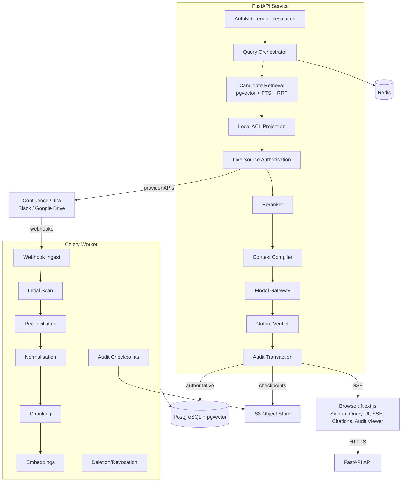

## Product Overview

A permission-safe cross-platform enterprise AI assistant spanning Confluence, Jira, Slack, and Google Drive. An authenticated enterprise user asks a natural-language question; the system retrieves candidate evidence across all connected sources, checks whether that exact user is currently allowed to access every candidate object via live provider authorisation, and generates one grounded answer with source citations. The core product promise is **permission-safe cross-platform retrieval** — security takes precedence over recall or latency. Restricted source content must never reach the LLM, reranker, logs, or browser.

## Core Features

- **Enterprise OIDC authentication** with server-derived tenant resolution; browser cannot supply tenant/source identity.
- **Source identity linking** via per-user delegated OAuth for Confluence/Jira, Slack, and Google Drive, binding immutable provider subject IDs to internal users.
- **Hybrid retrieval** (pgvector ANN + PostgreSQL FTS) with reciprocal-rank fusion; only IDs and metadata cross the authorisation boundary — never candidate text.
- **Local ACL projection** as an optimisation layer, followed by **live per-query reauthorisation** using user-scoped delegated credentials; positive access is query-scoped and never reused.
- **Reranking** of authorised evidence only, with source-diversity caps; deterministic, token-budgeted context compilation with prompt-injection defence.
- **Structured generation** with deterministic output verification (evidence ID validation, repair policy, extractive fallback).
- **Tamper-evident audit chain** (SHA-256 hash chain, S3 signed checkpoints, INSERT-only audit_events table); final answer is not emitted until audit commit succeeds.
- **SSE query progress streaming** with mapped human-readable progress states.
- **Citation reauthorisation** — opening a citation triggers a fresh provider access check; revoked access returns no title or text.
- **Webhook-driven ingestion** with idempotency keys, append-only object versions, priority deletion/ACL queues, reconciliation, and dead-letter handling.
- **Compliance audit viewer** restricted to compliance-role users; supports chain verification and tamper detection.
- **Five demo scenarios**: authorised cross-source query, restricted query exclusion, permission revocation, fresh-data update, and audit lookup with chain verification.

## Standards to Enforce

- **Code formatting**: Prettier (frontend), Ruff format (backend).
- **Linting**: ESLint (frontend), Ruff check + Pyright strict (backend).
- **Security**: SQL injection prevention via SQLAlchemy parameterised queries + RLS; CSRF protection; envelope encryption for all credentials; no secret/content logging; webhook signature verification; INSERT-only audit table.
- **British English** spelling consistency across all code, comments, docs, UI text, and error messages.
- **Package managers**: `uv` for Python, `yarn` (not npm) for frontend.

## Tech Stack

### Backend (services/api + services/worker)

- **Language**: Python 3.12
- **Framework**: FastAPI, Pydantic v2, pydantic-settings, Uvicorn
- **ORM**: SQLAlchemy 2 (async) + asyncpg
- **Database**: PostgreSQL + pgvector, Alembic migrations, PostgreSQL FTS, Row-Level Security
- **Queue**: Celery + Redis (broker + short-lived result backend only)
- **Auth**: PyJWT/OIDC verification, Authlib for OAuth flows
- **HTTP**: httpx (async)
- **Observability**: structlog (JSON logs), OpenTelemetry (tracing), Prometheus metrics
- **Encryption**: Envelope encryption with managed KMS key wrapping (AES-256-GCM for data key)
- **Tooling**: uv, Ruff, Pyright strict, pytest, pytest-asyncio, Testcontainers, respx

### Frontend (apps/web)

- **Framework**: Next.js (App Router), TypeScript, React Server Components
- **Styling**: Tailwind CSS + shadcn/ui
- **Validation**: Zod
- **API client**: openapi-typescript (generated from FastAPI OpenAPI)
- **SSE**: EventSource / fetch-stream wrapper
- **Testing**: Playwright (e2e), Vitest (unit)
- **Tooling**: yarn, ESLint, Prettier

### Infrastructure

- Docker Compose: postgres+pgvector, redis, api, worker, web, optional MinIO (S3 emulator)
- API and worker share one Docker image with different entrypoints

## Implementation Approach

The implementation follows the spec's 5-stage gating model (Stage 0–5) and the Epic A–H issue breakdown (Section 72), but reorganised for **maximum parallelism** across subagents. The key strategy:

1. **Standards & scaffolding first** (Epic A): Establish monorepo skeleton, Docker Compose, all 17 DB tables with Alembic migrations + RLS, config via pydantic-settings, CI pipeline, linting/formatting/type-checking toolchain. This is the dependency root — everything else builds on it.

2. **Parallel vertical slices**: Once the foundation exists, subagents work in parallel on independent vertical slices:

- Identity & Connections (Epic B)
- Connector framework + 4 connectors (Epic C)
- Ingestion pipeline (Epic D)
- Query pipeline (Epic E)
- Evidence & Audit (Epic F)
- Frontend (Epic G)
- Tests & Fixtures (Epic H)

3. **Integration & audit rounds**: After parallel implementation, combine modules and run two audit passes:

- **Round 1**: Module integration errors, missing implementations, import/type mismatches, DB migration consistency, API contract alignment.
- **Round 2**: Security vulnerabilities (all 9 invariants, all 10 SEC tests), backend-frontend contract misalignments, performance bottlenecks (event-loop blocking, N+1 queries, HNSW underfill, provider concurrency).

### Performance Considerations

- Query latency budget: ~250ms (auth+candidates) + ~1,500ms (live auth) + ~1,000ms (rerank+compile) + ~6,000ms (generation) + ~500ms (audit) = <10s target.
- All provider/model calls use async httpx; CPU-heavy reranking runs in worker/process pool.
- Per-provider semaphores (8 concurrent live checks each).
- HNSW filtered underfill fallback: iterative scan → widen lexical → exact vector scan.
- Short-lived DB transactions; never hold a transaction open across slow provider/model calls.
- Audit chain: SHA-256 over `canonical_json(event) || previous_hash`; canonical JSON with sorted keys.

### Reliability

- Idempotency keys: `{tenant}:{source}:{external_object_id}:{source_revision}` backed by DB unique constraints.
- Retry policy: bounded exponential backoff with jitter for transient errors; no retry on forbidden/permanent errors.
- Circuit breakers per source for ingestion; never convert unavailable → allow.
- Dead-letter handling after bounded retries; DL entries visible in admin endpoint only.
- Append-only object versions; new revision activates only after normalisation + ACL + chunks + embeddings commit atomically.

## Architecture Design



### Trust Boundaries (7 zones)

1. Browser (untrusted) → 2. API (post-auth) → 3. Authorisation boundary (IDs only) → 4. AI/model boundary (authorised evidence only) → 5. Source-provider boundary (untrusted) → 6. PostgreSQL (authoritative) → 7. Audit checkpoint zone (separate administration).

### Dependency Rule

```
api/routes → domain/use-cases → interfaces/protocols → infrastructure
```

Provider SDK types, HTTP payload types, and Celery task payloads must not leak into core domain objects.

## Directory Structure

```
tencent-hackathon-track2/
├── apps/web/                          # [NEW] Next.js frontend
│   ├── app/                           # App Router pages: query, audit, settings
│   ├── components/                    # shadcn/ui + custom components
│   ├── lib/{api,auth,sse}/           # API client, auth helpers, SSE stream
│   ├── tests/                        # Vitest + Playwright tests
│   ├── package.json                  # yarn-managed
│   ├── .eslintrc, .prettierrc        # frontend standards
│   └── tsconfig.json
│
├── services/api/                      # [NEW] FastAPI service
│   ├── src/app/
│   │   ├── api/routes/               # /v1/queries, /v1/evidence, /v1/audit, /v1/webhooks, /health
│   │   ├── api/dependencies/         # auth, tenant resolution, DB session
│   │   ├── auth/                     # oidc.py, identities.py, credentials.py
│   │   ├── connectors/               # protocol.py, confluence.py, jira.py, slack.py, google_drive.py, errors.py
│   │   ├── domain/                   # query_service.py, ingestion_service.py, evidence_service.py, types.py
│   │   ├── retrieval/               # vector.py, lexical.py, rrf.py, rerank.py, context.py
│   │   ├── authorisation/           # local_acl.py, live_check.py, policies.py
│   │   ├── models/                  # gateway.py, prompts/, output_schemas.py
│   │   ├── audit/                   # canonicalise.py, chain.py, capsule.py, verification.py
│   │   ├── persistence/             # models.py (SQLAlchemy), repositories/, session.py, rls.py
│   │   ├── observability/           # logging.py (structlog), tracing.py (OTel), metrics.py (Prom)
│   │   ├── settings.py              # pydantic-settings config
│   │   └── main.py                  # FastAPI app bootstrap
│   └── tests/                       # pytest unit + connector contract tests
│
├── services/worker/                   # [NEW] Celery worker
│   ├── src/worker/
│   │   ├── celery_app.py            # 10 queues, priority routing
│   │   ├── tasks/                   # webhook_ingest, source_fetch, normalise, chunk, embed, reconcile, audit_checkpoint
│   │   ├── pipelines/               # ingestion pipeline orchestration
│   │   └── scheduling/              # reconciliation scheduler
│   └── tests/
│
├── packages/contracts/                # [NEW] Shared contracts
│   ├── openapi/                      # FastAPI-generated OpenAPI JSON
│   ├── generated/                    # openapi-typescript output
│   └── schemas/                      # Celery message schema definitions
│
├── packages/fixtures/                 # [NEW] Synthetic test data
│   ├── confluence/                   # public + restricted pages
│   ├── jira/                         # shared + restricted issues
│   ├── slack/                        # public + private threads
│   └── drive/                        # shared + restricted docs
│
├── alembic/versions/                  # [NEW] Migration files for 17 tables + RLS + indexes
├── scripts/                           # [NEW] reset demo, seed fixtures, generate openapi
├── infra/docker/                      # [NEW] Dockerfiles for api/worker/web
├── infra/compose/                     # [NEW] docker-compose.yml
├── tests/                             # [NEW] Cross-service tests
│   ├── integration/                  # Testcontainers: migrations, RLS, vector, FTS, fusion, Celery
│   ├── security/                     # SEC-001 through SEC-010
│   ├── retrieval/                    # Golden query backtests
│   └── e2e/                          # Playwright 5 demo scenarios
│
├── docs/                              # [NEW] architecture.md, threat-model.md, demo-runbook.md, standards.md
├── pyproject.toml                     # [NEW] uv project: ruff, pyright, pytest, fastapi, sqlalchemy, celery, etc.
├── uv.lock                            # [NEW] Locked Python dependencies
├── docker-compose.yml                 # [NEW] Root compose (postgres, redis, api, worker, web, minio)
├── .env.example                       # [NEW] All env var names (no values)
├── implementation_plan.md             # [NEW] Detailed parallel implementation plan
├── .editorconfig                      # [NEW] British English, UTF-8, LF
├── .prettierrc                        # [NEW] Frontend formatting
├── .eslintrc                         # [NEW] Frontend linting
├── ruff.toml                          # [NEW] Backend formatting + linting
├── pyrightconfig.json                 # [NEW] Strict type checking
├── Makefile                           # [NEW] Wraps uv/yarn/docker commands
└── README.md                          # [NEW] Project overview + setup instructions
```

## Key Code Structures

### Connector Protocol (services/api/src/app/connectors/protocol.py)

```python
from typing import Protocol
from app.domain.types import Source, SourceConnection, DelegatedCredential


class Connector(Protocol):
    source: Source

    async def initial_scan(self, connection: SourceConnection, cursor: str | None) -> ScanPage: ...
    async def read_changes(
        self, connection: SourceConnection, cursor: str | None
    ) -> ChangePage: ...
    async def fetch_object(
        self, connection: SourceConnection, external_object_id: str
    ) -> FetchObjectResult: ...
    async def fetch_acl(
        self, connection: SourceConnection, external_object_id: str
    ) -> FetchAclResult: ...
    async def check_access(
        self, user_credential: DelegatedCredential, external_object_id: str
    ) -> AccessCheckResult: ...
```

### Query State Machine (services/api/src/app/domain/types.py)

```python
class QueryStatus(str, Enum):
    CREATED = "created"
    AUTHENTICATED = "authenticated"
    CANDIDATES = "candidates"
    REAUTHORISED = "reauthorised"
    RERANKED = "reranked"
    COMPILED = "compiled"
    GENERATED = "generated"
    VERIFIED = "verified"
    AUDITED = "audited"
    COMPLETED = "completed"
    PARTIAL = "partial"
    DENIED = "denied"
    FAILED = "failed"
```

### Generated Answer Schema (services/api/src/app/models/output_schemas.py)

```python
class GeneratedClaim(BaseModel):
    text: str
    evidence_ids: list[UUID]


class GeneratedAnswer(BaseModel):
    answer: str
    claims: list[GeneratedClaim]
```

### Audit Chain Hash (services/api/src/app/audit/chain.py)

```python
# event_hash_n = SHA-256(canonical_json(event_n) || previous_event_hash)
# First event uses fixed genesis marker
GENESIS_MARKER = "genesis-v1-00000000"
```

## Agent Extensions

### SubAgent

- **code-explorer**
- Purpose: Explore the growing codebase during integration and audit phases to locate import mismatches, missing implementations, type errors, and security invariant violations across the monorepo's multiple packages (api, worker, web, contracts, tests).
- Expected outcome: Comprehensive reports identifying all integration errors, missing modules, contract misalignments, and security gaps with exact file paths and line numbers for targeted fixes.