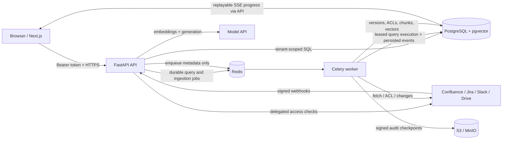

# Project Analysis — Tencent Hackathon Enterprise AI Assistant

**Snapshot date:** 8 October 2026
**Analysed branch:** `jess`
**Project stage:** Functionally substantial prototype with a verified backend demo path; not yet a repeatable browser demo or production-ready system.

## Executive summary

This project is a permission-safe enterprise search and answer system for Confluence, Jira, Slack, and Google Drive. A user asks one question, the backend retrieves possible evidence, checks that user's current provider permissions, gives only authorised text to the answer model, verifies citations, and writes a tamper-evident audit record before returning the answer.

The most important design choice is sound:

> Authorisation is part of retrieval, not a filter applied after generation.

The repository now contains much more than scaffolding. It has a FastAPI API, provider OAuth flows and connectors, a multi-stage Celery ingestion pipeline, hybrid PostgreSQL/pgvector retrieval, live permission checks, answer verification, audit-chain logic, and a polished Next.js interface.

The main weakness is now full-product integration readiness rather than backend execution semantics. Deterministic fixture seeding and the Chronicle backend foundation pass fresh- and upgraded-database PostgreSQL smoke runs, including current and historical queries, role-based visibility, control events, capsules, backtests, chain verification and checkpoint export. Query creation now publishes a dedicated Celery task, a database lease prevents concurrent execution, and real pipeline stages are persisted and replayed through reconnect-safe SSE. However, these checks are not yet automated in CI, the frontend dependency state is inconsistent, repository-wide lint and strict type checks retain pre-existing failures, and the Chronicle-specific browser journey is incomplete.

## Current assessment

| Area | Status | Assessment |
|---|---|---|
| Product concept | Strong | Clear enterprise problem and differentiated security promise. |
| Backend architecture | Strong prototype | Boundaries between API, domain, persistence, connectors, retrieval, audit, and workers are clear. |
| Database design | Substantial | PostgreSQL, pgvector, FTS, RLS, immutable versions, audit events, and migrations are present. |
| Provider integrations | Implemented, unverified live | Real HTTP/OAuth logic exists for all four sources, but there are no live sandbox integration tests. |
| Ingestion | Mostly implemented | Fetch, normalise, ACL, chunk, embed, activate, delete, reconcile, and webhook tasks exist. |
| Query pipeline | Strong prototype | Hybrid retrieval through audited answer generation runs in Celery with a database lease and replayable persisted progress events. |
| Security controls | Good prototype foundation | Fail-closed checks, live reauthorisation, RLS, encrypted content, and audit-before-response are represented. |
| Frontend | Feature-complete prototype UI | Login, source settings, query progress, citations, evidence, and audit views exist. Dependency setup is currently inconsistent. |
| Automated tests | Useful but incomplete | 42 backend tests pass; PostgreSQL/worker smoke proof exists, but most automated tests remain unit or isolated simulations. |
| Demo readiness | Medium-high for backend, medium overall | The deterministic backend, worker query path and smoke validator work against PostgreSQL, but the Chronicle UI and a repeatable clean-checkout browser run are still missing. |
| Production readiness | Low | Build reproducibility, identity UX, database roles, integration tests, operations, and quality gates need work. |

## What the product does

The application, branded as **Relay** in the frontend, aims to provide one permission-aware search and answer experience across:

- Confluence pages
- Jira issues
- Slack messages and threads
- Google Drive files and Google Workspace documents

The intended user experience is:

1. Sign in with an enterprise identity.
2. Connect source accounts with delegated OAuth.
3. Ask a natural-language question.
4. See progress while the system searches connected sources.
5. Receive a grounded answer with citations from currently authorised evidence.
6. Open a citation, triggering another live permission check.
7. Allow compliance users to inspect an evidence and access-decision audit capsule.

## Architecture



### Main components

| Component | Technology | Responsibility |
|---|---|---|
| Web | Next.js 16, React 19, Tailwind 4 | Login, source connections, query UI, SSE events, citations, evidence, audit view. |
| API | FastAPI, Pydantic | Authentication, OAuth, queries, evidence reauthorisation, webhooks, health, audit endpoints. |
| Worker | Celery | Scans, reconciliation, content fetching, normalisation, ACL resolution, chunking, embeddings, deletions, checkpoints. |
| Primary store | PostgreSQL 16 + pgvector | Tenant data, versions, chunks, ACLs, query state, evidence, and audit chain. |
| Queue | Redis | Celery broker/backend and ephemeral coordination only. |
| Object store | S3-compatible / MinIO | Externally stored audit-chain checkpoints. |
| Model layer | OpenAI-compatible HTTP calls plus a dev stub | Embeddings and structured answer generation. Current reranking is deterministic, not model-based. |

## Repository map

```text
apps/web/                       Next.js user interface
services/api/src/app/
  api/                          HTTP routes and dependencies
  auth/                         OIDC, credentials, identity links, OAuth state
  authorisation/                Local ACL projection and live provider checks
  connectors/                   Confluence, Jira, Slack, Drive adapters
  retrieval/                    Vector/lexical search, RRF, rerank, context, verify
  models/                       Model gateway and structured output schemas
  audit/                        Hash chain, capsule, verification, checkpoints
  persistence/                  SQLAlchemy models, sessions, tenant scoping
  domain/                       Query, evidence, ingestion, audit services
services/worker/src/worker/     Celery application and ingestion tasks
alembic/                        Database migrations
packages/fixtures/              Synthetic source-shaped fixture files
scripts/                        OpenAPI, reset, and seed utilities
tests/                          Unit, security, retrieval, integration, and pipeline tests
infra/docker/                   API, worker, and web images
```

## Core flows

### Query and answer flow

The main query path is implemented in `services/api/src/app/retrieval/pipeline.py`:

1. The API authenticates the bearer token and derives the tenant server-side.
2. The plaintext question is encrypted before it is stored in `query_runs`; `query.queued` is committed in the same transaction.
3. `POST /queries` publishes a dedicated Celery job. The worker acquires a row-locked execution lease, so duplicate deliveries cannot execute concurrently.
4. The model gateway embeds the question.
5. PostgreSQL vector and lexical searches return candidate IDs and scores without candidate text.
6. Reciprocal Rank Fusion combines both rankings.
7. Local ACL projection rejects known-denied candidates but never treats a local allow as authoritative.
8. Live provider checks run with delegated user credentials and a bounded deadline.
9. Text is loaded only for objects receiving a live `allow` result.
10. Evidence is ranked and capped for source diversity.
11. A deterministic context compiler marks evidence as untrusted and applies a token budget.
12. The model returns a structured answer and claim-to-evidence mappings.
13. Citation verification rejects unknown or unauthorised evidence IDs.
14. Generation is retried once; a verified extractive fallback is used if repair fails.
15. Real stage events are committed as the pipeline advances. The answer, evidence, access decisions, terminal event and audit-chain event are atomically committed before completion is observable.
16. SSE only reads `query_events`; `Last-Event-ID` resumes from the next sequence without restarting work.

This flow embodies the project's strongest security property: unauthorised text should not enter reranking, prompts, model calls, logs, or the browser.

### Citation opening

Opening `/v1/evidence/{evidence_id}` does not blindly return the stored citation. The service:

1. Checks the tenant and original query owner.
2. Resolves the current source identity link.
3. Performs a new live provider access check.
4. Returns only `access_revoked` if access is no longer allowed.
5. Decrypts and returns the quoted span only after a current allow decision.

### Ingestion flow


Important ingestion behaviours already represented in code include:

- Provider-specific scan and change APIs.
- Webhook signature checks and delivery deduplication.
- Append-only object versions.
- Duplicate revision detection.
- Quarantine on ACL or embedding failure.
- Embedding reuse by chunk hash.
- Higher-priority deletion and ACL queues.
- Replacement activation only after chunks and embeddings are ready.
- Reconciliation jobs to repair missed or out-of-order events.

## Security model

### Implemented controls

- Tenant identity is derived from validated token claims, not request bodies.
- Production startup fails when critical identity, provider, model, signing, or object-store settings are absent.
- Development tokens are accepted only when `APP_ENV=development`.
- All tenant tables use PostgreSQL row-level security in the initial migration.
- Candidate retrieval returns IDs and scores before live authorisation.
- Missing identities and credentials deny access; there is no service-account fallback in the query path.
- Provider ambiguity, timeouts, and errors do not grant access.
- Query and answer text are encrypted at rest.
- Citation text is reauthorised when opened.
- Logs filter known sensitive fields.
- Webhook signatures and replay windows are checked before enqueueing.
- Audit events form a per-tenant SHA-256 hash chain.
- Audit checkpoints are HMAC-signed and written to S3-compatible storage.
- API responses receive content, framing, referrer, permissions, and production HSTS headers.

### Security caveats

- The Compose database uses one `assistant` role for migrations and runtime. A production deployment should separate owner/migration and restricted runtime roles; otherwise the runtime role remains too powerful even with grants and RLS.
- Real provider permission semantics have not been validated by automated sandbox tests. Provider APIs can contain edge cases around inherited permissions, Slack membership, shared drives, and Atlassian security levels.
- The frontend login screen currently calls the development-login endpoint. A complete production OIDC browser flow is not present in the UI.
- OAuth and delegated-token storage are implemented, but token refresh, revocation, and provider lifecycle behaviour need integration testing.
- The model gateway is hard-coded to OpenAI endpoints even though `MODEL_PROVIDER` exists as configuration.

## Data model

The SQLAlchemy schema contains 26 tables:

| Group | Tables |
|---|---|
| Identity and tenancy | `tenants`, `users`, `source_connections`, `encrypted_credentials`, `identity_links` |
| Source content | `source_objects`, `object_versions`, `chunks` |
| Permissions | `principals`, `acl_grants` |
| Ingestion | `ingestion_cursors`, `webhook_deliveries`, `dead_letter_tasks` |
| Query and audit | `query_runs`, `query_events`, `access_decisions`, `evidence_items`, `evidence_capsules`, `audit_events`, `audit_checkpoints` |
| Chronicle graph and regression | `claims`, `policy_versions`, `backtest_cases`, `backtest_runs`, `backtest_results`, `fixture_events` |

Notable database features:

- `pgvector` and `pg_trgm` extensions.
- HNSW vector index and GIN full-text index.
- Generated full-text search vector maintenance.
- Forced RLS policies keyed by `app.tenant_id`.
- Immutable local source revision history.
- A unique ingestion cursor migration to prevent duplicate cursors.
- An audit table intended to be insert/select only for the application role.
- Monotonic per-query progress events and an expiring execution lease for safe worker delivery/replay.

## API surface

| Method | Endpoint | Purpose |
|---|---|---|
| `POST` | `/v1/auth/dev-login` | Issue a local-only development token. |
| `GET` | `/v1/oauth/connections` | List connected sources for the current user. |
| `GET` | `/v1/oauth/{provider}/start` | Start Atlassian, Slack, or Google OAuth. |
| `GET` | `/v1/oauth/{provider}/callback` | Exchange provider code and persist identity/credentials. |
| `POST` | `/v1/queries` | Create an encrypted query run. |
| `GET` | `/v1/queries/{id}/events` | Read and replay persisted SSE events; this endpoint never executes the pipeline. |
| `GET` | `/v1/queries/{id}` | Fetch the stored final answer and citations. |
| `GET` | `/v1/evidence/{id}` | Reauthorise and fetch citation evidence. |
| `GET` | `/v1/audit/{query_id}` | Fetch a compliance-only evidence capsule. |
| `POST` | `/v1/webhooks/{source}` | Receive signed provider webhook events. |
| `GET` | `/health/live` | Process liveness. |
| `GET` | `/health/ready` | Database, Redis, migration, and model readiness. |
| `GET` | `/metrics` | Prometheus metrics. |

## Frontend

The Next.js application contains:

- A marketing/landing page.
- Development sign-in and local token storage.
- Source connection settings for Atlassian, Slack, and Google.
- Query suggestions and a streaming progress UI.
- Partial-result and error states.
- Citation components and a separately reauthorised evidence page.
- A compliance audit view.
- A cohesive glass-panel visual design with responsive layouts.

The frontend API client is handwritten. OpenAPI generation exists, but the generated client workflow is not currently the source used by the application.

## Model behaviour

There are two gateway implementations:

- `StubModelGateway`: used in development without an API key. It returns zero embeddings and builds a deterministic answer from the first authorised evidence block.
- `HttpModelGateway`: calls OpenAI-compatible embedding and Chat Completions endpoints and requests strict JSON-schema output.

Current limitations:

- `MODEL_PROVIDER` does not select different implementations.
- `RERANK_MODEL` is configured but not used; reranking is deterministic and based on fused score plus local rules.
- Zero embeddings make vector ranking meaningless in API-key-free development; lexical retrieval must carry the demo.
- Prompt and output schemas are versioned in files, but generation currently constructs its messages directly in Python rather than loading the prompt file.

## Verified quality status

The following checks were run against this snapshot:

| Check | Result |
|---|---|
| Backend tests | **Pass:** 42 tests in 0.82 seconds. |
| Targeted changed-file Ruff | **Pass.** |
| Targeted changed-file Pyright | **Pass:** 0 errors; existing warning debt remains. |
| Ruff lint | **Fail:** 44 findings, mostly magic HTTP constants and long lines in the isolated pipeline test. |
| Pyright strict | **Fail:** 48 errors and 582 warnings. The configuration also reports `$schema` as unrecognised. |
| Frontend TypeScript | **Pass:** `tsc --noEmit`. |
| Frontend ESLint | **Fail:** local dependencies cannot resolve `eslint-config-next/core-web-vitals`. |
| Frontend tests | **Fail/no coverage:** no test files; the local install also lacks `@tailwindcss/postcss`. |
| Browser E2E | Not run; the test file exists but the dependency/build state is not currently reproducible. |

The 42 passing backend tests cover:

- RRF and retrieval ordering.
- Context sanitisation and token budgets.
- Source-diversity behaviour.
- Security invariants such as no candidate text before authorisation.
- Audit canonicalisation and hash chaining.
- Provider-shaped payload normalisation.
- Authorised, restricted, timeout, missing-identity, revocation, freshness, and fabricated-citation scenarios in an isolated in-memory pipeline.
- The durable-query structural guarantees: SSE cannot invoke the pipeline, lease fields exist, and the worker task/queue are explicitly registered.
- Async database engine and session-factory disposal between synchronous Celery invocations.

They do **not** yet automate the browser or live-provider path end to end. The accompanying smoke validator has separately exercised the actual PostgreSQL migration, seed, temporal query, permission, capsule, backtest and checkpoint paths against both fresh and upgraded databases. A live Compose check also proved `POST /queries` → Redis → Celery → PostgreSQL → SSE: one execution attempt, a released lease, nine ordered events and cursor replay returning only the unseen terminal event.

## Main gaps and risks

### 1. The demo path is not yet automated end to end

`scripts/seed_fixtures.py` now seeds the deterministic four-source Chronicle incident, temporal versions, direct fixture ACLs, claims, control events and backtest cases. `scripts/reset_demo.py` includes the Chronicle tables and re-seeds after truncation. Fresh- and upgraded-database PostgreSQL smoke runs pass, but the validator is still an operator-run script rather than a CI integration suite and there is no Chronicle browser flow.

**Impact:** the backend scenarios are repeatable, but a judge cannot yet reproduce the complete product experience with one command and a browser.

### 2. Frontend dependency metadata is inconsistent

The tracked project contains `yarn.lock`, while the working tree also contains an untracked npm v1 lockfile describing older Next.js 15 dependencies. The current Dockerfile and Makefile use npm, but `package.json` now requires Next.js 16 and Tailwind 4.

**Impact:** clean web builds are not deterministic and the current local install is stale.

**Decision required:** standardise on npm with a regenerated npm lockfile, or standardise on Yarn and update Docker/Makefile accordingly. Keep only one lockfile.

### 3. Local runtime configuration has a port mismatch

Compose exposes PostgreSQL on host port `5434`, while `.env.example` defaults to `localhost:5432`. Container-to-container networking works through Compose overrides, but the README's hybrid workflow—Docker infrastructure plus host API—will point at the wrong port.

### 4. Quality gates are not green

The repository declares Ruff and strict Pyright as standards, but both currently fail. This weakens the usefulness of `make ci` and makes it hard to tell new failures from accepted debt.

### 5. Integration coverage is shallow

The provider-shaped isolated pipeline tests are valuable, but there are no verified tests covering:

- Alembic migrations against PostgreSQL with pgvector.
- RLS cross-tenant isolation in a real database.
- Celery task retry/crash recovery under forced lease contention.
- Webhook deduplication in PostgreSQL.
- OAuth callback persistence.
- Real or sandbox provider permission checks.
- Model API schema handling.
- Full browser query/citation/audit flows.

### 6. Some advertised capabilities remain placeholders

- The original Celery retrieval-backtest task remains a placeholder; the new Chronicle API runner currently evaluates role/time visibility, leakage and no-hindsight but not full answer or citation drift.
- Fixture seeding is validated against fresh and upgraded PostgreSQL databases but still needs automated CI coverage.
- Production OIDC login UI is not implemented.
- Alternative model providers are not implemented.
- Model-based reranking is not implemented.

### 7. Observability needs deployment configuration

Metrics and structured logging are present. Tracing is instrumented, but the OTLP exporter points to `${APP_BASE_URL}/v1/traces`, while this application exposes no trace collector endpoint there.

**Impact:** trace export will fail unless an external compatible collector is deliberately mapped to that URL.

### 8. Working-tree state needs consolidation

The `jess` branch currently includes uncommitted runtime/documentation edits and untracked files. Before a shared PR, the team should decide which local Docker fixes and package-lock changes are intentional, then commit only the desired set.

## Recommended next steps

### Priority 0 — Make the project reproducible

1. Choose npm or Yarn and regenerate exactly one frontend lockfile.
2. Make Dockerfile, Makefile, README, and CI use that package manager consistently.
3. Align `.env.example` with the Compose PostgreSQL host port.
4. Make `make ci` pass: fix Ruff, Pyright configuration, and actual type errors.
5. Add a single `make demo-up` or equivalent that builds, migrates, seeds, and verifies readiness.

### Priority 1 — Automate the proven backend

1. Convert the validated migration/seed/query/event/checkpoint/worker smoke path into an isolated PostgreSQL and Redis CI integration suite.
2. Add forced worker redelivery, active-lease contention and expired-lease recovery tests.
3. Add a forced audit-commit failure test proving that no terminal success event or answer becomes observable.
4. Record a fresh-stack backend demo run from clone to successful audit lookup.

### Priority 2 — Complete the Chronicle product loop

1. Build the PRD Chronicle UI surfaces: timeline/as-of control, Evidence Capsule, Knowledge Audit, backtests and fixture controls.
2. Turn the role/time/grant/revoke/update scenarios into browser tests.
3. Improve the deterministic development model path from a single-span answer to useful multi-source synthesis.
4. Drive the Chronicle backtest runner through the same full query pipeline.
5. Store and classify answer/citation drift against versioned baselines.

### Priority 3 — Validate the security promise

1. Run RLS tests against PostgreSQL using two tenants and a restricted runtime role.
2. Add provider contract tests for allow, deny, inherited access, missing identity, expiry, timeout, deletion, and rate limiting.
3. Separate migration-owner and application database roles.
4. Test that denied content is absent from logs, prompts, traces, and HTTP responses using real pipeline boundaries.
5. Exercise revocation between answer generation and citation opening.

### Priority 4 — Production hardening

1. Implement the production browser OIDC flow and secure session/token handling.
2. Add provider token refresh and revocation lifecycle handling.
3. Configure a real OTLP collector and verify trace redaction.
4. Add dead-letter operations, retention jobs, alerts, dashboards, and recovery runbooks.
5. Add deployable hosted infrastructure and secret/KMS integrations.

## Suggested demo-readiness definition

The project is demo-ready when all of the following are true:

- A clean checkout starts with one documented command sequence.
- Migrations and fixture seeding succeed without manual database edits.
- Alice and Bob receive different answers according to fixture permissions.
- Restricted text is absent from model input and browser responses.
- Revoking access removes evidence from the next query and from citation opening.
- A content update activates the new revision while retaining the old revision for audit.
- A compliance user can retrieve a verified audit capsule.
- Backend lint, types, tests, frontend lint, frontend types, and browser E2E are green.
- The same demo succeeds twice after a full reset.

## Key strengths to preserve

- The central security principle is explicit and reflected in module boundaries.
- Provider-neutral domain types prevent provider SDK objects leaking into core logic.
- Candidate retrieval is designed to avoid loading text before authorisation.
- Citation reauthorisation directly addresses permission revocation.
- Append-only source versions and audit events support reconstruction.
- The UI communicates source connection, progress, citations, partial results, and audit data clearly.
- The isolated pipeline tests capture the most important failure cases and provide a good base for real integration tests.

## Bottom line

This is a well-conceived, security-first hackathon system with a surprisingly broad implementation. Its architecture is more mature than its operational polish. The fastest route to a convincing result is not adding more features; it is making the existing path deterministic:

1. fix dependency and configuration reproducibility,
2. prove fixture seeding and reset against a fresh migrated database,
3. automate the now-decoupled worker/event path in CI,
4. make quality checks green, and
5. complete the Chronicle browser journey and security assertions.

Once those pieces are complete, the repository should support a strong demonstration of its core differentiator: useful cross-source answers without weakening each source's access controls.

## Chronicle PRD alignment — 2026-10-08 implementation checkpoint

`chronicle_prd_for_codex.md` remains the target product and acceptance plan. This document records what the code proves today. The current branch now contains a substantial Chronicle Core backend foundation, but it is not yet the completed PRD.

### Current delivery estimate

- Existing permission-safe assistant foundation: strong.
- Chronicle-specific backend foundation: roughly 72% complete.
- Full hackathon MVP, including UI and proven end-to-end exit criteria: roughly 55% complete.

These figures are engineering estimates, not acceptance results. A stage is only complete after its stated tests and demo path pass against PostgreSQL.

### Stage-by-stage tracker

| PRD stage | Current status | Evidence in the code | Remaining exit work |
|---|---|---|---|
| Stage 0 — Security skeleton | In progress | Four fixture source connections use the existing connector boundary and perform a fresh database-backed `check_access` decision. PostgreSQL smoke runs prove Bob's deny/grant/revoke transitions. | Add captured model-request/log assertions across all four sources and automate the database checks in CI. |
| Stage 1 — Bitemporal foundation | In progress | Migration `0004` adds temporal identity/ACL fields, claims, policy versions, capsules, checkpoints, fixture events and backtest records. The Chronicle fixture seeds temporal versions and ACLs. | Make every real ingestion ACL/content mutation append-only; add late-observation, tenant-isolation and update-state integration tests. |
| Stage 2 — Query pipeline | Implemented; CI proof pending | `POST /v1/queries` accepts timezone-aware `asOf` and publishes a Celery job. A database lease guards execution. Vector, lexical, exact-scan, identity, ACL and authorised-text loading apply no-hindsight filtering. Every real stage is persisted in `query_events`; SSE is read-only and resumes using `Last-Event-ID`. Fresh/upgraded PostgreSQL smoke runs and a live Compose worker run pass. | Promote the golden role/time/worker/reconnect cases into isolated CI tests and add forced lease-expiry/redelivery coverage. |
| Stage 3 — Atomic audit and replay | In progress | Query completion atomically persists evidence IDs, version IDs, content hashes, configuration versions, a sealed context hash, an Evidence Capsule and audit event. Chain-verification and checkpoint endpoints exist. | Prove forced audit failure suppresses output; add checkpoint tamper/rewrite tests and a repeatable external-store demonstration. |
| Stage 4 — Knowledge audit and backtesting | Foundation implemented | `/v1/knowledge-audit/findings` deterministically reports conflict, staleness, access-risk and process-gap findings. `/v1/backtests/runs` persists role/time visibility, leakage and no-hindsight results with configuration versions. | Extend runs through the full answer/citation pipeline, store baselines, classify answer/citation drift and prove deliberate regressions. |
| Stage 5 — Demo hardening | Not started | Fixture seed and grant/revoke/content-update control endpoints provide backend demo primitives. | Build the six Chronicle UI surfaces, wire the `asOf` picker and controls, generate client types, and create a clean reset-to-demo E2E test. |
| Optional Stage 6 — Real connector | Existing but unverified | Confluence, Jira, Slack and Drive connector modules already exist. | Defer until the fixture-first Core MVP is accepted; then validate one delegated OAuth connector end to end. |

### Backend capabilities added in this checkpoint

- Deterministic Chronicle fixture: `PAY-2026-042` across Confluence, Jira, Slack and Google Drive, with Alice, contractor Bob and a compliance user.
- Point-in-time query input and bitemporal content, identity and ACL filtering.
- Current live permission recheck remains mandatory even for a historical query.
- Immutable-style content update and permission grant/revoke fixture playback.
- Authorized Context manifest and SHA-256 snapshot bound to evidence version/content hashes.
- Persisted Evidence Capsule plus configuration-version replay fields.
- Detailed audit-chain verification and persisted signed-checkpoint metadata.
- Deterministic Knowledge Auditor findings.
- Curated role/time visibility backtest runs and stored regression results.
- Dedicated background query execution with a database lease and explicit Celery queue.
- Real, monotonic query-stage events plus read-only cursor-based SSE replay.

### API delta

```text
POST /v1/queries                              # now accepts optional asOf
GET  /v1/queries/{queryId}/events             # persisted read-only replay; Last-Event-ID supported
POST /v1/audit/verify-chain                  # detailed first-failure report
POST /v1/audit/checkpoints                   # sign/export/persist chain head
GET  /v1/knowledge-audit/findings            # deterministic findings
POST /v1/backtests/runs                      # run curated visibility suite
GET  /v1/backtests/runs/{runId}              # inspect versioned results
POST /v1/demo/fixtures/events/{eventId}/apply # grant, revoke, content update
```

### Highest-priority path to the PRD backend

1. Promote the passing migration `0005`, fixture, Alice/Bob/current/`asOf`/grant/revoke/update/worker/reconnect smoke scenarios into isolated PostgreSQL and Redis CI integration tests.
2. Add forced query redelivery, lease expiry and audit-commit failure tests.
3. Drive backtests through the same production query pipeline, using a deterministic captured model gateway, so citation and answer drift are measured rather than inferred from visibility.
4. Replace delete-and-reinsert ACL ingestion with append-and-retire semantics everywhere.
5. Add audit-row tampering and exported-checkpoint mismatch tests.
6. Wire the Chronicle UI and its browser E2E path; keep the optional real connector last.

The key architectural direction now matches the PRD: fixture-first, bitemporal, permission-safe, sealed, replayable and backtestable. The core database and production-style worker query path have working smoke proof; the main remaining gaps are automated integration evidence, full-pipeline regression backtests, append-only ACL mutation everywhere and the Chronicle-specific frontend.
